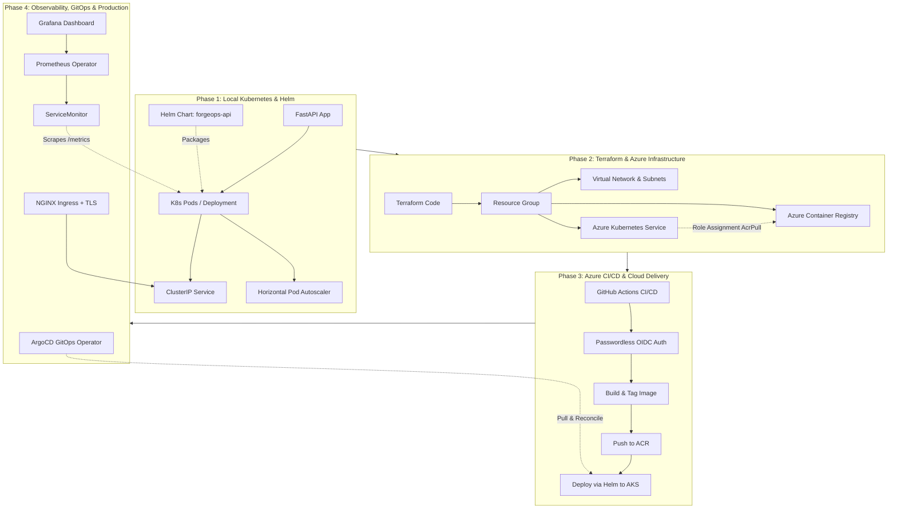

# ForgeOps Platform Documentation & Learning Roadmap

Welcome to the **ForgeOps** documentation hub. This repository contains the complete learning and implementation roadmap for turning a containerized application into an enterprise-ready, automated DevOps platform on Microsoft Azure.

---

> [!TIP]
> **New to DevOps, Kubernetes, Prometheus, or CI/CD?**
> Start with the beginner-friendly guide: [**DevOps Fundamentals in Plain English**](devops-fundamentals.md) for real-world analogies, conceptual explanations, and a cheat sheet before diving into the phase guides below.

---

## Architecture Overview

---

## Roadmap Phases

Each phase is documented in depth with underlying architectural concepts, visual diagrams, complete implementation code, and step-by-step verification commands:

| Phase | Guide | Focus Area | Key Technologies |
| :--- | :--- | :--- | :--- |
| **Phase 1** | [**Kubernetes & Helm Guide**](phase-1-kubernetes-and-helm.md) | Local cluster orchestration, declarative manifests, scaling, and dynamic packaging. | `kubectl`, Pods, Deployments, Services, HPA, Helm 3 |
| **Phase 2** | [**Terraform & Azure IaC Guide**](phase-2-terraform-azure-iac.md) | Reproducible cloud infrastructure, remote state, network isolation, and managed Kubernetes. | Terraform, Azure (RG, VNet, ACR, AKS, Managed Identities) |
| **Phase 3** | [**CI/CD & Cloud Deployment Guide**](phase-3-azure-cicd-deployment.md) | Passwordless authentication (OIDC), automated image publishing, and continuous delivery. | GitHub Actions, Azure OIDC Federation, ACR, Helm Deployment |
| **Phase 4** | [**GitOps & Observability Guide**](phase-4-gitops-observability-production.md) | Declarative cluster sync, Kubernetes-native monitoring, ingress routing, and TLS certificates. | ArgoCD, Prometheus Operator, ServiceMonitor, NGINX Ingress |

---

## Learning Objectives

By progressing through these phases, you will master:
1. **Container Orchestration**: The shift from Docker Compose to multi-node declarative Kubernetes management.
2. **Infrastructure as Code (IaC)**: Managing cloud infrastructure with Terraform modules, state locking, and least-privilege security.
3. **Enterprise DevSecOps**: Hardening build pipelines with vulnerability scanners (`trivy`, `pip-audit`, `gitleaks`) and eliminating long-lived cloud credentials using OpenID Connect (OIDC).
4. **GitOps & Observability**: Implementing reconciliation loops with ArgoCD and monitoring cloud-native metrics via Prometheus Operator.
