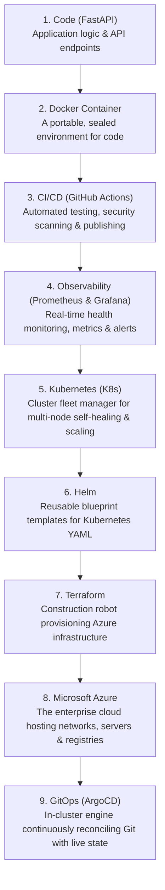
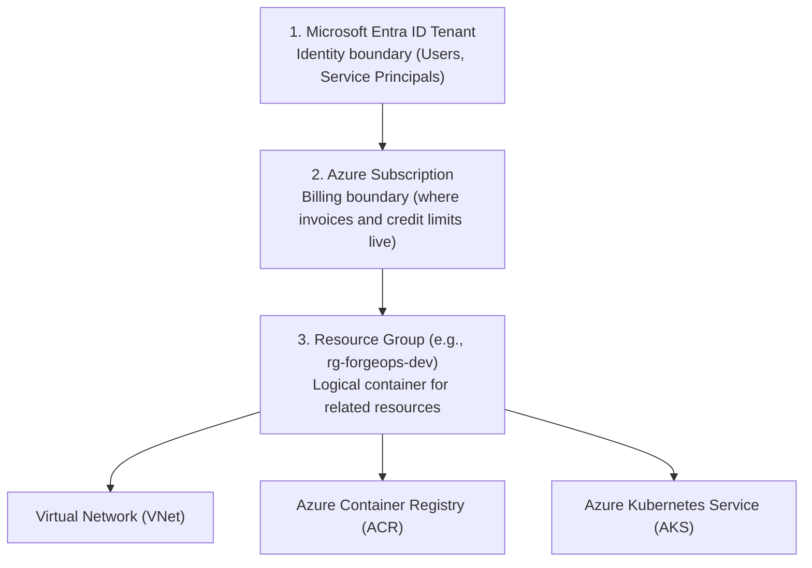

# DevOps & Cloud Fundamentals: The Complete Guide

If you are new to DevOps and cloud computing, this guide breaks down every piece of the puzzle in plain English: from core concepts to container orchestration, Azure cloud architecture, and real-world observability.

---

## 1. The Big Picture: How It All Connects



---

## 2. Core DevOps Disciplines & Concepts

### 2.1 The Problem DevOps Solves
Historically, **Developers** wrote code and handed it off to **Operations** engineers to run on physical servers.
- When it crashed, Devs said: *"It worked on my machine; it's an Ops problem!"*
- Ops said: *"Your code is broken; we won't deploy it!"*
- Releases took months, were full of bugs, and required late-night weekend emergency deployments.

**DevOps** bridges this divide: developers and operations use **shared automation, containerization, and infrastructure-as-code** to deliver small, frequent, and reliable updates continuously.

### 2.2 SRE & The 4 Golden Signals (Google Standard)
Site Reliability Engineering (SRE) defines 4 essential metrics to monitor for any system:
1. **Latency**: Time taken to service a request (e.g., is p95 latency under 200ms?).
2. **Traffic**: Demand placed on the system (e.g., requests per second).
3. **Errors**: Rate of requests that fail (e.g., HTTP 500 errors).
4. **Saturation**: How close the infrastructure is to its limits (e.g., 85% CPU or memory capacity).

### 2.3 Shift-Left Security (DevSecOps)
Instead of waiting for security audits right before production launch:
- Scan dependencies on every commit (`pip-audit`).
- Scan git history for accidentally leaked passwords/tokens (`gitleaks`).
- Scan container images for operating system vulnerabilities (`trivy`).

---

## 3. Microsoft Azure: Cloud Concepts Demystified

### 3.1 What is Cloud Computing?
Instead of buying physical computers, cooling systems, and power supplies in an office closet, you rent computing capacity from Microsoft's global data centers on a pay-as-you-go basis.

### 3.2 Azure Resource Hierarchy
Azure organizes all resources in a structured hierarchy:



1. **Entra ID Tenant (formerly Azure AD)**: Manages authentication, users, and security permissions.
2. **Subscription**: Links to your payment method and defines cloud spending limits.
3. **Resource Group (RG)**: A folder that holds related Azure resources. Deleting the Resource Group cleanly deletes everything inside it, preventing orphaned, costly resources.

### 3.3 Azure Regions & Availability Zones
- **Region**: A geographical area containing multiple data centers (e.g., `East US`, `West Europe`, `Central India`).
- **Availability Zone (AZ)**: Distinct physical data centers within a region, each with independent power, cooling, and networking. Running an AKS cluster across 3 Availability Zones guarantees that even if a flood or power failure strikes one data center, your app stays online.

### 3.4 Key Azure Services Used in ForgeOps
* **Azure Virtual Network (VNet)**: Your private, isolated slice of the Azure cloud. Subnets partition this network to separate Kubernetes nodes from public load balancers.
* **Azure Container Registry (ACR)**: A private, secure Docker registry hosted inside Azure to store and scan your container images.
* **Azure Kubernetes Service (AKS)**: A fully managed Kubernetes control plane. Microsoft manages master nodes, backups, and API server uptime for free; you only pay for the worker virtual machines (VMs) running your pods.
* **Managed Identity**: Allows Azure resources (like AKS worker nodes) to authenticate to other Azure services (like ACR) automatically without storing passwords in config files or secrets.

---

## 4. Observability: Prometheus & Grafana in Depth

### 4.1 Prometheus Metric Types
Prometheus collects numeric data over time (time-series data). It supports 4 primary metric types:

| Metric Type | Behavior | Real-World Example in ForgeOps |
| :--- | :--- | :--- |
| **Counter** | Value only goes up (or resets to 0 on restart). | `api_requests_total`: Total count of requests received. |
| **Gauge** | Value can go up or down at any time. | `active_users_current`, CPU temperature, memory usage. |
| **Histogram** | Samples observations (usually durations or sizes) into configurable buckets. | `api_request_duration_seconds`: Measures latency percentiles (p50, p90, p99). |
| **Summary** | Similar to histogram, calculates configurable quantiles directly on the client. | Request payload sizes. |

### 4.2 PromQL (Prometheus Query Language) Cheatsheet
Grafana uses PromQL to turn Prometheus raw numbers into graphs:

1. **Calculate Requests Per Second (RPS)**:
   ```promql
   sum(rate(api_requests_total[1m]))
   ```
2. **Calculate Error Rate Percentage**:
   ```promql
   sum(rate(api_requests_total{status=~"5.."}[1m])) / sum(rate(api_requests_total[1m])) * 100
   ```
3. **Calculate 95th Percentile Response Time (Latency)**:
   ```promql
   histogram_quantile(0.95, sum(rate(api_request_duration_seconds_bucket[5m])) by (le))
   ```

### 4.3 How to Populate Grafana with Rich Traffic
By default, a new local app has zero traffic. To light up Grafana:
1. **Add test routes to the app**:
   - `/` -> 200 OK (fast, 5ms)
   - `/slow` -> 200 OK (sleeps for 200–500ms to generate high latency curves)
   - `/error` -> 500 Internal Server Error (to trigger error spikes and alerts)
2. **Run a Traffic Simulator**: A script running parallel requests against your endpoints to simulate 50–100 active users.

---

## 5. Do We Need a Frontend?

### The Short Answer
- **For Infrastructure/DevOps Evaluation**: No. In production, engineers rely on Grafana for observability, ArgoCD for deployments, and OpenAPI/Swagger (`/docs`) for API testing.
- **For a Portfolio / Demonstration Platform**: **Yes, strongly recommended!**

### What a Dedicated DevOps Frontend Adds to ForgeOps
A sleek web UI turns abstract code into an engaging product:
1. **Interactive Traffic Generator**: Sliders on the web page to inject 100 req/sec, trigger error spikes, or simulate DDoS attacks.
2. **Live Cluster & Pod Topology**: Visual cards showing active Kubernetes pods, restart counts, and health statuses.
3. **Pipeline & Rollout Controls**: Buttons to trigger canary rollouts, view build commit SHAs, and monitor rolling updates in real time.

---

## 6. Summary Comparison Table

| Tool | Category | Key Responsibility |
| :--- | :--- | :--- |
| **FastAPI** | Application | High-performance Python backend with built-in Prometheus instrumentation. |
| **Docker** | Containerization | Packages code, runtime, and dependencies into an immutable image. |
| **Kubernetes (K8s)** | Orchestration | Keeps pods running, performs rolling updates, auto-scales on load. |
| **Helm** | Templating & Packaging | Manages environment-specific configuration (`dev` vs `prod`) cleanly. |
| **Terraform** | Infrastructure as Code | Builds Azure VNets, ACR, and AKS clusters automatically from code. |
| **Azure (AKS/ACR)** | Cloud Platform | Cloud provider hosting the infrastructure and private registry. |
| **GitHub Actions** | CI/CD Automation | Runs tests, audits dependencies, builds images, and triggers deployments. |
| **Prometheus** | Metrics Collection | Pulls time-series metrics from `/metrics` every 15 seconds. |
| **Grafana** | Visualization | Plots PromQL queries into real-time operational graphs and dashboards. |
| **ArgoCD** | GitOps Delivery | Continuously reconciles cluster state to match the Git repository. |
