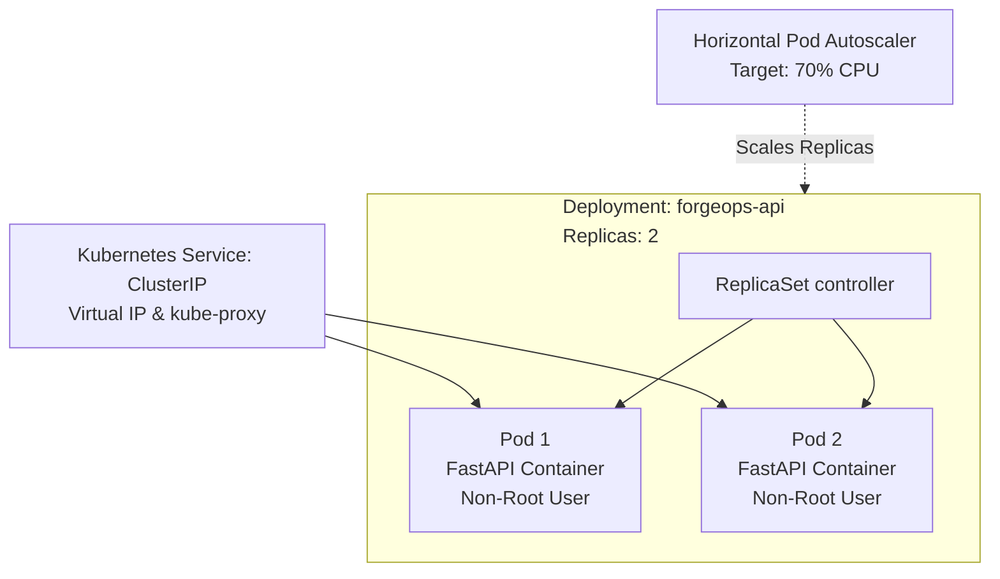

# Phase 1: Local Kubernetes Orchestration & Helm Packaging

This guide covers the transition from single-node Docker Compose orchestration to declarative, self-healing Kubernetes workloads and parameterizable Helm packaging.

---

## 1. What We Are Doing

1. Transitioning our containerized FastAPI service from Docker Compose into standard Kubernetes manifests (`Deployment`, `Service`, `ConfigMap`, `HPA`).
2. Configuring production-grade pod lifecycle controls: resource limits/requests, health/readiness probes, and non-root security contexts.
3. Packaging the raw manifests into a reusable **Helm 3 Chart** with dynamic `values.yaml` environments (e.g., local dev vs cloud staging).
4. Validating and running the application on a local cluster (Docker Desktop Kubernetes, Minikube, or Kind).

---

## 2. Underlying Concepts

### 2.1 Docker Compose vs. Kubernetes
| Dimension | Docker Compose | Kubernetes (K8s) |
| :--- | :--- | :--- |
| **Target Scale** | Single-host developer environment | Multi-node, distributed production clusters |
| **Self-Healing** | Container restart policies (`restart: unless-stopped`) | Pod rescheduling across healthy physical nodes when a node fails |
| **Deployments** | Rebuilds or restarts entire service | Zero-downtime rolling updates, canary, and instant rollbacks |
| **Autoscaling** | Manual (`docker compose up --scale api=3`) | Dynamic via Horizontal Pod Autoscaler (HPA) based on CPU/RAM/metrics |
| **Service Discovery** | Embedded Docker DNS | Cluster DNS (`CoreDNS`), ClusterIP virtual IPs, and kube-proxy load balancing |

### 2.2 Core Kubernetes Primitives


- **Pod**: The smallest deployable computing unit in Kubernetes. A pod encapsulates one or more containers, shared storage volumes, and a unique network IP.
- **Deployment & ReplicaSet**: A Deployment provides declarative updates for Pods. You describe the *desired state*, and the Deployment Controller changes the *actual state* to the desired state at a controlled rate via a ReplicaSet.
- **Service (ClusterIP)**: Pods are ephemeral; their IP addresses change when recreated. A `Service` provides a stable internal IP address and DNS name (`forgeops-api.forgeops.svc.cluster.local`) load-balancing traffic across matching pods.
- **Probes**:
  - **Liveness Probe** (`/health`): Informs K8s whether the container is alive. If it fails, K8s restarts the container.
  - **Readiness Probe** (`/health`): Informs K8s when the container is ready to accept traffic. If it fails, K8s removes the Pod from the Service's endpoint pool so users do not receive errors.
- **Resource Requests & Limits**:
  - `requests`: What K8s scheduler uses to place the pod on an appropriate node.
  - `limits`: Hard cap enforced by Linux cgroups. If memory limit is exceeded, container is OOMKilled (Out Of Memory).

### 2.3 Why Helm?
Raw Kubernetes YAML manifests are static. In real-world environments, you have different requirements for local, staging, and production (e.g., image tags, replica counts, CPU limits, domain names).

**Helm** acts as the package manager and templating engine for Kubernetes:
- Parameterizes YAML files using Go templates (`{{ .Values.replicaCount }}`).
- Manages release history, versioning, and atomic rollbacks (`helm rollback`).
- Packages applications into distributable `.tgz` archives.

---

## 3. Implementation Step-by-Step

### 3.1 Raw Kubernetes Manifests (`k8s/`)

Create the directory structure:
```text
k8s/
├── namespace.yaml
├── configmap.yaml
├── deployment.yaml
├── service.yaml
└── hpa.yaml
```

#### `k8s/namespace.yaml`
Isolates the project resources into a dedicated namespace:
```yaml
apiVersion: v1
kind: Namespace
metadata:
  name: forgeops
  labels:
    app.kubernetes.io/name: forgeops
```

#### `k8s/configmap.yaml`
Decouples non-sensitive application configuration from the container image:
```yaml
apiVersion: v1
kind: ConfigMap
metadata:
  name: forgeops-config
  namespace: forgeops
data:
  APP_ENV: "production"
  LOG_LEVEL: "INFO"
```

#### `k8s/deployment.yaml`
Defines the desired pod state, rolling update strategy, security contexts, probes, and resource bounds:
```yaml
apiVersion: apps/v1
kind: Deployment
metadata:
  name: forgeops-api
  namespace: forgeops
  labels:
    app.kubernetes.io/name: forgeops-api
spec:
  replicas: 2
  strategy:
    type: RollingUpdate
    rollingUpdate:
      maxSurge: 1
      maxUnavailable: 0
  selector:
    matchLabels:
      app.kubernetes.io/name: forgeops-api
  template:
    metadata:
      labels:
        app.kubernetes.io/name: forgeops-api
    spec:
      securityContext:
        runAsNonRoot: true
        runAsUser: 1000
        fsGroup: 1000
      containers:
        - name: api
          image: forgeops-api:latest
          imagePullPolicy: IfNotPresent
          ports:
            - name: http
              containerPort: 8000
          envFrom:
            - configMapRef:
                name: forgeops-config
          resources:
            requests:
              cpu: 100m
              memory: 128Mi
            limits:
              cpu: 500m
              memory: 256Mi
          livenessProbe:
            httpGet:
              path: /health
              port: http
            initialDelaySeconds: 5
            periodSeconds: 10
            timeoutSeconds: 2
            failureThreshold: 3
          readinessProbe:
            httpGet:
              path: /health
              port: http
            initialDelaySeconds: 3
            periodSeconds: 5
            timeoutSeconds: 2
            failureThreshold: 2
```

#### `k8s/service.yaml`
Exposes the pods internally within the cluster:
```yaml
apiVersion: v1
kind: Service
metadata:
  name: forgeops-api
  namespace: forgeops
  labels:
    app.kubernetes.io/name: forgeops-api
spec:
  type: ClusterIP
  selector:
    app.kubernetes.io/name: forgeops-api
  ports:
    - name: http
      port: 80
      targetPort: http
```

#### `k8s/hpa.yaml`
Automatically scales pods between 2 and 5 replicas based on CPU utilization:
```yaml
apiVersion: autoscaling/v2
kind: HorizontalPodAutoscaler
metadata:
  name: forgeops-api-hpa
  namespace: forgeops
spec:
  scaleTargetRef:
    apiVersion: apps/v1
    kind: Deployment
    name: forgeops-api
  minReplicas: 2
  maxReplicas: 5
  metrics:
    - type: Resource
      resource:
        name: cpu
        target:
          type: Utilization
          averageUtilization: 70
```

---

### 3.2 Helm Chart Architecture (`charts/forgeops-api/`)

Instead of maintaining hardcoded YAML files for every environment, we build a Helm chart:

```text
charts/forgeops-api/
├── Chart.yaml
├── values.yaml
├── values-dev.yaml
├── values-prod.yaml
└── templates/
    ├── _helpers.tpl
    ├── configmap.yaml
    ├── deployment.yaml
    ├── service.yaml
    └── hpa.yaml
```

#### `charts/forgeops-api/Chart.yaml`
```yaml
apiVersion: v2
name: forgeops-api
description: Production-grade Helm chart for ForgeOps API
type: application
version: 0.1.0
appVersion: "1.0.0"
```

#### `charts/forgeops-api/values.yaml` (Default configuration)
```yaml
replicaCount: 2

image:
  repository: forgeops-api
  tag: latest
  pullPolicy: IfNotPresent

service:
  type: ClusterIP
  port: 80
  targetPort: 8000

autoscaling:
  enabled: true
  minReplicas: 2
  maxReplicas: 5
  targetCPUUtilizationPercentage: 70

resources:
  requests:
    cpu: 100m
    memory: 128Mi
  limits:
    cpu: 500m
    memory: 256Mi

env:
  APP_ENV: "production"
  LOG_LEVEL: "INFO"
```

#### `charts/forgeops-api/templates/_helpers.tpl`
```text
{{/*
Expand the name of the chart.
*/}}
{{- define "forgeops-api.name" -}}
{{- default .Chart.Name .Values.nameOverride | trunc 63 | trimSuffix "-" }}
{{- end }}

{{/*
Common labels
*/}}
{{- define "forgeops-api.labels" -}}
helm.sh/chart: {{ include "forgeops-api.name" . }}-{{ .Chart.Version | replace "+" "_" }}
app.kubernetes.io/name: {{ include "forgeops-api.name" . }}
app.kubernetes.io/instance: {{ .Release.Name }}
app.kubernetes.io/managed-by: {{ .Release.Service }}
{{- end }}

{{/*
Selector labels
*/}}
{{- define "forgeops-api.selectorLabels" -}}
app.kubernetes.io/name: {{ include "forgeops-api.name" . }}
app.kubernetes.io/instance: {{ .Release.Name }}
{{- end }}
```

#### `charts/forgeops-api/templates/deployment.yaml`
```yaml
apiVersion: apps/v1
kind: Deployment
metadata:
  name: {{ include "forgeops-api.name" . }}
  labels:
    {{- include "forgeops-api.labels" . | nindent 4 }}
spec:
  {{- if not .Values.autoscaling.enabled }}
  replicas: {{ .Values.replicaCount }}
  {{- end }}
  selector:
    matchLabels:
      {{- include "forgeops-api.selectorLabels" . | nindent 6 }}
  template:
    metadata:
      labels:
        {{- include "forgeops-api.selectorLabels" . | nindent 8 }}
    spec:
      securityContext:
        runAsNonRoot: true
        runAsUser: 1000
      containers:
        - name: {{ .Chart.Name }}
          image: "{{ .Values.image.repository }}:{{ .Values.image.tag | default .Chart.AppVersion }}"
          imagePullPolicy: {{ .Values.image.pullPolicy }}
          ports:
            - name: http
              containerPort: {{ .Values.service.targetPort }}
          envFrom:
            - configMapRef:
                name: {{ include "forgeops-api.name" . }}-config
          resources:
            {{- toYaml .Values.resources | nindent 12 }}
          livenessProbe:
            httpGet:
              path: /health
              port: http
            initialDelaySeconds: 5
            periodSeconds: 10
          readinessProbe:
            httpGet:
              path: /health
              port: http
            initialDelaySeconds: 3
            periodSeconds: 5
```

---

## 4. Local Execution & Validation

### Step 1: Enable Kubernetes
In **Docker Desktop**:
1. Open **Settings** -> **Kubernetes**.
2. Check **Enable Kubernetes** and click **Apply & Restart**.
3. Verify connection:
   ```bash
   kubectl cluster-info
   kubectl get nodes
   ```

### Step 2: Build the Docker Image Locally
```bash
docker build -t forgeops-api:latest .
```

### Step 3: Test Raw Manifests
```bash
kubectl apply -f k8s/namespace.yaml
kubectl apply -f k8s/
kubectl get pods -n forgeops
kubectl get svc -n forgeops
```

Test access via port-forwarding:
```bash
kubectl port-forward svc/forgeops-api 8080:80 -n forgeops
# In another terminal or browser:
curl http://localhost:8080/health
curl http://localhost:8080/metrics
```

### Step 4: Test with Helm
Lint your chart to verify template syntax:
```bash
helm lint charts/forgeops-api
```

Simulate installation with `--dry-run`:
```bash
helm install forgeops-api ./charts/forgeops-api -n forgeops --create-namespace --dry-run
```

Install and upgrade release:
```bash
helm upgrade --install forgeops-api ./charts/forgeops-api -n forgeops --create-namespace
helm list -n forgeops
```

---

## 5. Learning Checkpoints & Questions to Ponder

1. **Why does readiness probe failure keep the pod alive while liveness probe failure terminates it?**
   - *Answer*: If your app is temporarily overloaded or warming up a cache, killing it restarts the cold-boot penalty. Readiness failure simply temporarily halts traffic routing until the pod recovers.
2. **What happens during a Rolling Update if `maxUnavailable` is set to 0?**
   - *Answer*: Kubernetes guarantees that 100% of desired pods remain available throughout the update, creating the new pod before terminating the old one.
