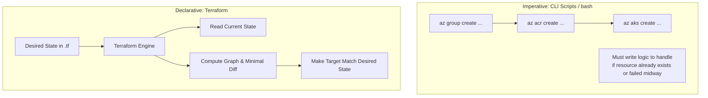
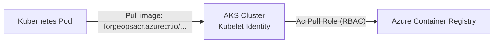

# Phase 2: Infrastructure as Code (IaC) with Terraform & Azure

This guide covers building automated, version-controlled cloud infrastructure on Microsoft Azure using Terraform.

---

## 1. What We Are Doing

1. Writing declarative Terraform configuration to provision:
   - **Azure Resource Group** (logical containment and lifecycle boundary).
   - **Azure Virtual Network (VNet) & Subnet** (private networking backbone for our cluster).
   - **Azure Container Registry (ACR)** (private container image repository).
   - **Azure Kubernetes Service (AKS)** (managed Kubernetes cluster with system node pools).
   - **Azure Managed Identity & RBAC** (granting AKS permission to pull images from ACR without managing static passwords).
2. Configuring an **Azure Blob Storage Remote Backend** to store Terraform state with lease-based locking.
3. Organizing Terraform into reusable, modular code (`modules/networking`, `modules/acr`, `modules/aks`).

---

## 2. Underlying Concepts

### 2.1 Declarative IaC vs Imperative Scripts


- **Imperative (e.g., Azure CLI / Bash)**: You specify *how* to do things step-by-step. If a script fails midway, you must write complex conditional error handling to make it idempotent.
- **Declarative (Terraform)**: You declare *what* the end state should look like. Terraform computes the dependency graph, determines the exact differences between the real world and your code, and applies only the required additions or modifications.

### 2.2 Terraform State & Locking
- **`terraform.tfstate`**: A JSON file mapping your configuration to real-world Azure resource IDs. It keeps track of resource metadata and dependencies.
- **Why Remote State?** Storing state in Git risks exposing sensitive values (like secrets) and causes conflicts when multiple engineers or CI pipelines run simultaneously.
- **Azure Blob Storage Backend**: Uses native Azure Blob storage leases for distributed locking. When `terraform apply` runs, a blob lease is acquired; any concurrent run will safely fail rather than corrupting state.

### 2.3 AKS Identity & Secure ACR Integration
In legacy architectures, Kubernetes pulled images from private registries using an image pull secret (`kubectl create secret docker-registry ...`) containing static username and passwords that expire or leak.

In modern Azure DevOps architectures:

- AKS uses an **Azure Managed Identity**.
- Terraform grants this identity the Azure role **`AcrPull`** on the ACR resource.
- When an AKS node pulls an image, Azure handles authentication automatically via internal token exchange. No credentials are stored in Kubernetes secrets.

### 2.4 AKS Networking: Kubenet vs. Azure CNI
- **Kubenet (Basic)**: Pods receive IP addresses from a private virtual overlay network inside the node. Traffic is NAT'ed via iptables. Preserves IP address space in your corporate VNet.
- **Azure CNI (Advanced)**: Every pod receives a real, routable IP address directly from the Azure Subnet. Enables native integration with Azure VNet security rules, but requires planning a larger subnet CIDR.

---

## 3. Implementation Step-by-Step

### 3.1 Directory Structure
```text
terraform/
├── backend.tf
├── main.tf
├── variables.tf
├── outputs.tf
├── terraform.tfvars.example
└── modules/
    ├── networking/
    │   ├── main.tf
    │   ├── variables.tf
    │   └── outputs.tf
    ├── acr/
    │   ├── main.tf
    │   ├── variables.tf
    │   └── outputs.tf
    └── aks/
        ├── main.tf
        ├── variables.tf
        └── outputs.tf
```

---

### 3.2 Step 0: Bootstrap the Remote State Storage (One-Time Setup)

Before running Terraform with a remote backend, we create the Azure Storage Account using Azure CLI:

```bash
# Variables
RESOURCE_GROUP_NAME="rg-forgeops-tfstate"
STORAGE_ACCOUNT_NAME="stforgeopstfstate$RANDOM"
CONTAINER_NAME="tfstate"
LOCATION="eastus"

# Create resource group
az group create --name $RESOURCE_GROUP_NAME --location $LOCATION

# Create storage account (must be globally unique)
az storage account create \
  --name $STORAGE_ACCOUNT_NAME \
  --resource-group $RESOURCE_GROUP_NAME \
  --location $LOCATION \
  --sku Standard_LRS \
  --encryption-services blob

# Create blob container for state
az storage container create \
  --name $CONTAINER_NAME \
  --account-name $STORAGE_ACCOUNT_NAME
```

---

### 3.3 Root Terraform Files

#### `terraform/backend.tf`
```hcl
terraform {
  required_version = ">= 1.5.0"
  required_providers {
    azurerm = {
      source  = "hashicorp/azurerm"
      version = "~> 3.90"
    }
  }

  backend "azurerm" {
    resource_group_name  = "rg-forgeops-tfstate"
    storage_account_name = "REPLACE_WITH_YOUR_STORAGE_ACCOUNT"
    container_name       = "tfstate"
    key                  = "forgeops.dev.terraform.tfstate"
  }
}

provider "azurerm" {
  features {}
}
```

#### `terraform/variables.tf`
```hcl
variable "environment" {
  type        = string
  description = "Environment name (dev, staging, prod)"
  default     = "dev"
}

variable "location" {
  type        = string
  description = "Azure region for all resources"
  default     = "eastus"
}

variable "project_name" {
  type        = string
  description = "Prefix for project resources"
  default     = "forgeops"
}

variable "aks_node_count" {
  type        = number
  description = "Number of worker nodes for the default node pool"
  default     = 2
}

variable "aks_vm_size" {
  type        = string
  description = "VM SKU for the worker nodes"
  default     = "Standard_B2s" # Cost-effective burstable SKU for learning
}
```

#### `terraform/main.tf`
```hcl
locals {
  name_prefix = "${var.project_name}-${var.environment}"
  common_tags = {
    Project     = "ForgeOps"
    Environment = var.environment
    ManagedBy   = "Terraform"
  }
}

resource "azurerm_resource_group" "rg" {
  name     = "rg-${local.name_prefix}"
  location = var.location
  tags     = local.common_tags
}

module "networking" {
  source              = "./modules/networking"
  resource_group_name = azurerm_resource_group.rg.name
  location            = azurerm_resource_group.rg.location
  name_prefix         = local.name_prefix
  tags                = local.common_tags
}

module "acr" {
  source              = "./modules/acr"
  resource_group_name = azurerm_resource_group.rg.name
  location            = azurerm_resource_group.rg.location
  name_prefix         = replace(local.name_prefix, "-", "") # ACR names must be alphanumeric
  tags                = local.common_tags
}

module "aks" {
  source              = "./modules/aks"
  resource_group_name = azurerm_resource_group.rg.name
  location            = azurerm_resource_group.rg.location
  name_prefix         = local.name_prefix
  subnet_id           = module.networking.aks_subnet_id
  node_count          = var.aks_node_count
  vm_size             = var.aks_vm_size
  acr_id              = module.acr.acr_id
  tags                = local.common_tags
}
```

#### `terraform/outputs.tf`
```hcl
output "resource_group_name" {
  value = azurerm_resource_group.rg.name
}

output "acr_login_server" {
  value       = module.acr.login_server
  description = "Login server for docker push"
}

output "aks_cluster_name" {
  value = module.aks.cluster_name
}

output "get_credentials_command" {
  value       = "az aks get-credentials --resource-group ${azurerm_resource_group.rg.name} --name ${module.aks.cluster_name}"
  description = "Command to configure local kubectl to connect to the new cluster"
}
```

---

### 3.4 Modules Implementation

#### `terraform/modules/networking/main.tf`
```hcl
resource "azurerm_virtual_network" "vnet" {
  name                = "vnet-${var.name_prefix}"
  location            = var.location
  resource_group_name = var.resource_group_name
  address_space       = ["10.0.0.0/16"]
  tags                = var.tags
}

resource "azurerm_subnet" "aks_subnet" {
  name                 = "snet-aks"
  resource_group_name  = var.resource_group_name
  virtual_network_name = azurerm_virtual_network.vnet.name
  address_prefixes     = ["10.0.1.0/24"]
}
```

#### `terraform/modules/acr/main.tf`
```hcl
resource "azurerm_container_registry" "acr" {
  name                = "acr${var.name_prefix}"
  resource_group_name = var.resource_group_name
  location            = var.location
  sku                 = "Standard" # Allows replication and high throughput
  admin_enabled       = false      # Hardened: rely on Azure Active Directory & Managed Identity
  tags                = var.tags
}
```

#### `terraform/modules/aks/main.tf`
```hcl
resource "azurerm_kubernetes_cluster" "aks" {
  name                = "aks-${var.name_prefix}"
  location            = var.location
  resource_group_name = var.resource_group_name
  dns_prefix          = "k8s-${var.name_prefix}"

  default_node_pool {
    name           = "systempool"
    node_count     = var.node_count
    vm_size        = var.vm_size
    vnet_subnet_id = var.subnet_id
    os_disk_size_gb = 30
    tags           = var.tags
  }

  identity {
    type = "SystemAssigned"
  }

  network_profile {
    network_plugin    = "kubenet"
    load_balancer_sku = "standard"
  }

  tags = var.tags
}

# Attach ACR to AKS using Kubelet Identity
resource "azurerm_role_assignment" "aks_to_acr" {
  scope                = var.acr_id
  role_definition_name = "AcrPull"
  principal_id         = azurerm_kubernetes_cluster.aks.kubelet_identity[0].object_id
}
```

---

## 4. Execution Workflow

### Step 1: Initialize Terraform
Downloads provider plugins and connects to the Azure remote state backend:
```bash
terraform -chdir=terraform init
```

### Step 2: Format & Validate Code
```bash
terraform -chdir=terraform fmt
terraform -chdir=terraform validate
```

### Step 3: Generate Execution Plan
Computes exactly what Azure resources will be created, modified, or destroyed:
```bash
terraform -chdir=terraform plan -out=tfplan
```

### Step 4: Apply Infrastructure
Provisions the live resources on Azure:
```bash
terraform -chdir=terraform apply tfplan
```

### Step 5: Connect `kubectl` to Azure AKS
Retrieve kubeconfig credentials using Azure CLI:
```bash
az aks get-credentials --resource-group rg-forgeops-dev --name aks-forgeops-dev
kubectl get nodes
```

---

## 5. Learning Checkpoints & Cost Controls

1. **How to keep Azure costs low during practice?**
   - Use `Standard_B2s` VM size for AKS nodes (burstable, low-cost).
   - Use `Standard` or `Basic` ACR SKU.
   - Run `terraform destroy` when not actively using the cluster to stop incurring node charges.
2. **Why is `admin_enabled = false` best practice for ACR?**
   - Enabling admin creates a permanent, static root username/password that can be compromised. Role-Based Access Control (RBAC) with Managed Identities ensures passwordless, auditable authentication.
