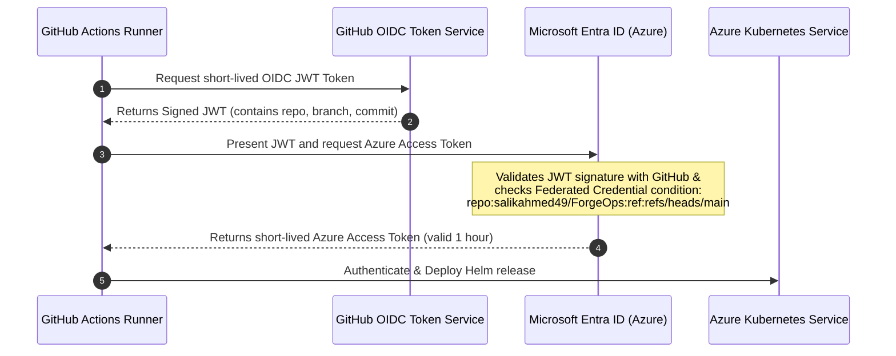

# Phase 3: Continuous Deployment & Cloud Delivery via GitHub Actions

This guide covers automating image builds, publishing to Azure Container Registry (ACR), and zero-downtime rolling deployments to Azure Kubernetes Service (AKS) using GitHub Actions and passwordless authentication.

---

## 1. What We Are Doing

1. Upgrading our CI pipeline into a full **Continuous Delivery (CD)** pipeline.
2. Implementing **Passwordless Authentication** via OpenID Connect (OIDC) between GitHub Actions and Microsoft Entra ID (Azure AD).
3. Automatically building and pushing immutable container images tagged with the Git commit SHA (`${{ github.sha }}`) to ACR.
4. Deploying the updated application onto AKS using Helm with `--atomic` rollout validation.
5. Executing post-deployment smoke tests to ensure zero-downtime releases.

---

## 2. Underlying Concepts

### 2.1 The Problem with Static Service Principal Secrets
Traditionally, CI systems authenticated to Azure using a Service Principal client secret (`AZURE_CREDENTIALS` stored in GitHub Secrets).
- **Security Risks**: Client secrets are static passwords. They can be leaked in pipeline logs, stolen by rogue pull requests, or forgotten until they expire unexpectedly in production.
- **Maintenance Burden**: Requires recurring secret rotation every 90-180 days.

### 2.2 Modern Solution: Workload Identity Federation (OIDC)


1. GitHub generates a cryptographically signed JSON Web Token (JWT) containing metadata about the repository, workflow, and git branch.
2. Azure Entra ID inspects the token signature against GitHub's public keys.
3. Azure checks that the subject claim matches the pre-configured **Federated Credential** (e.g., branch `refs/heads/main` in repo `salikahmed49/ForgeOps`).
4. If valid, Azure exchanges the token for a temporary Azure access token. **No permanent secrets ever exist in GitHub.**

### 2.3 Immutable Image Tagging vs `:latest`
Using `:latest` in production Kubernetes causes subtle, dangerous failures:
- If a pod crashes and restarts, it may pull a different `:latest` than the other pods in the same ReplicaSet.
- `helm rollback` or `kubectl rollout undo` cannot revert to a previous version because the image tag never changed.
- **Best Practice**: Every build produces an immutable tag based on the commit SHA (`forgeops-api:61e8a40`) or semantic release (`v1.0.4`).

---

## 3. Implementation Step-by-Step

### 3.1 Step 1: Configure Azure Federated OIDC Credentials

Run these commands using the Azure CLI:

```bash
# Variables
APP_NAME="sp-forgeops-github-actions"
SUBSCRIPTION_ID=$(az account show --query id -o tsv)
REPO_NAME="salikahmed49/ForgeOps" # Your GitHub username/repo

# 1. Create Entra ID Application
APP_ID=$(az ad app create --display-name $APP_NAME --query appId -o tsv)

# 2. Create Service Principal for the App
SP_ID=$(az ad sp create --id $APP_ID --query id -o tsv)

# 3. Create Federated Identity Credential for the main branch
az ad app federated-credential create \
  --id $APP_ID \
  --parameters '{
    "name": "gh-actions-main-branch",
    "issuer": "https://token.actions.githubusercontent.com",
    "subject": "repo:'"$REPO_NAME"':ref:refs/heads/main",
    "description": "Deploy to Azure from main branch",
    "audiences": ["api://AzureADTokenExchange"]
  }'

# 4. Grant Contributor role on the Resource Group to the Service Principal
RG_NAME="rg-forgeops-dev"
az role assignment create \
  --role "Contributor" \
  --assignee $APP_ID \
  --scope "/subscriptions/$SUBSCRIPTION_ID/resourceGroups/$RG_NAME"

# 5. Grant Azure Kubernetes Service Cluster Admin Role
AKS_NAME="aks-forgeops-dev"
az role assignment create \
  --role "Azure Kubernetes Service Cluster User Role" \
  --assignee $APP_ID \
  --scope "/subscriptions/$SUBSCRIPTION_ID/resourceGroups/$RG_NAME/providers/Microsoft.ContainerService/managedClusters/$AKS_NAME"
```

---

### 3.2 Step 2: Configure GitHub Repository Secrets & Variables

In your GitHub repository, navigate to **Settings** -> **Secrets and variables** -> **Actions**:

#### Variables (`Configuration` tab):
- `AZURE_CLIENT_ID`: The `$APP_ID` output from Step 1.
- `AZURE_TENANT_ID`: Your Azure AD Directory ID (`az account show --query tenantId -o tsv`).
- `AZURE_SUBSCRIPTION_ID`: Your Azure Subscription ID.
- `ACR_NAME`: Your Azure Container Registry name (e.g., `acrforgeopsdev`).
- `AKS_CLUSTER_NAME`: `aks-forgeops-dev`
- `AKS_RESOURCE_GROUP`: `rg-forgeops-dev`

*(Notice: None of these are sensitive passwords or keys; they are non-secret identifiers!)*

---

### 3.3 Step 3: Azure CD GitHub Actions Workflow

Create [`.github/workflows/deploy-azure.yml`](file:///d:/devops-automation-platform/.github/workflows/deploy-azure.yml):

```yaml
name: Deploy to Azure AKS

on:
  push:
    branches:
      - main
  workflow_dispatch:

permissions:
  id-token: write # Required for requesting the OIDC JWT token
  contents: read

jobs:
  build-and-publish:
    name: Build & Push Container to ACR
    runs-on: ubuntu-latest

    steps:
      - name: Checkout code
        uses: actions/checkout@v4

      - name: Azure Login via OIDC
        uses: azure/login@v2
        with:
          client-id: ${{ vars.AZURE_CLIENT_ID }}
          tenant-id: ${{ vars.AZURE_TENANT_ID }}
          subscription-id: ${{ vars.AZURE_SUBSCRIPTION_ID }}

      - name: Login to ACR
        run: |
          az acr login --name ${{ vars.ACR_NAME }}

      - name: Build and Push Docker Image
        env:
          ACR_REGISTRY: ${{ vars.ACR_NAME }}.azurecr.io
          IMAGE_TAG: ${{ github.sha }}
        run: |
          docker build \
            -t $ACR_REGISTRY/forgeops-api:$IMAGE_TAG \
            -t $ACR_REGISTRY/forgeops-api:latest .
          docker push $ACR_REGISTRY/forgeops-api:$IMAGE_TAG
          docker push $ACR_REGISTRY/forgeops-api:latest

  deploy-to-aks:
    name: Deploy Helm Release to AKS
    runs-on: ubuntu-latest
    needs: build-and-publish

    steps:
      - name: Checkout code
        uses: actions/checkout@v4

      - name: Azure Login via OIDC
        uses: azure/login@v2
        with:
          client-id: ${{ vars.AZURE_CLIENT_ID }}
          tenant-id: ${{ vars.AZURE_TENANT_ID }}
          subscription-id: ${{ vars.AZURE_SUBSCRIPTION_ID }}

      - name: Set AKS Context
        uses: azure/aks-set-context@v4
        with:
          resource-group: ${{ vars.AKS_RESOURCE_GROUP }}
          cluster-name: ${{ vars.AKS_CLUSTER_NAME }}

      - name: Install Helm
        uses: azure/setup-helm@v4
        with:
          version: "v3.14.0"

      - name: Deploy via Helm
        env:
          ACR_REGISTRY: ${{ vars.ACR_NAME }}.azurecr.io
          IMAGE_TAG: ${{ github.sha }}
        run: |
          helm upgrade --install forgeops-api ./charts/forgeops-api \
            --namespace forgeops \
            --create-namespace \
            --set image.repository=$ACR_REGISTRY/forgeops-api \
            --set image.tag=$IMAGE_TAG \
            --atomic \
            --timeout 5m0s

      - name: Verify Deployment Rollout
        run: |
          kubectl rollout status deployment/forgeops-api -n forgeops --timeout=60s
          kubectl get pods -n forgeops -l app.kubernetes.io/name=forgeops-api
```

---

## 4. Disaster Recovery & Rollback Strategy

If a faulty build introduces a runtime bug not caught by unit tests:

### 1. Instant Helm Rollback
You can immediately revert to the previous working release revision without rebuilding images:
```bash
# View release revision history
helm history forgeops-api -n forgeops

# Rollback to revision 2
helm rollback forgeops-api 2 -n forgeops
```

### 2. Why `--atomic` in Helm?
The `--atomic` flag used in our GitHub Actions pipeline ensures that if any pod fails its readiness probe within the 5-minute timeout, Helm will automatically roll back the deployment and fail the CI/CD job, protecting live users from downtime.
