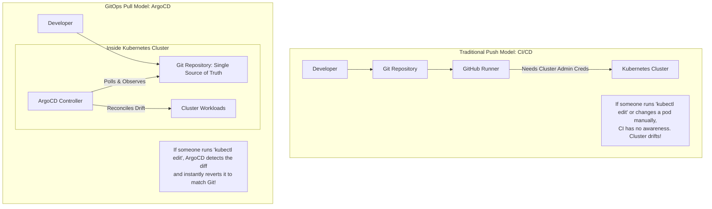

# Phase 4: Production Observability, GitOps & Cluster Hardening

This guide covers advanced enterprise DevOps patterns: transition from push CI/CD to **GitOps (ArgoCD)**, Kubernetes-native metrics collection with **Prometheus Operator**, and cluster security hardening.

---

## 1. What We Are Doing

1. Implementing **GitOps with ArgoCD**: Replacing push-based pipeline deployments with an in-cluster reconciliation agent that synchronizes the cluster state with Git.
2. Deploying the **Prometheus Operator (`kube-prometheus-stack`)** to automatically scrape `/metrics` using declarative `ServiceMonitor` resources.
3. Configuring an **NGINX Ingress Controller** with automatic HTTPS certificates via **Let's Encrypt / cert-manager**.
4. Enforcing **Pod Security Standards** to prevent privileged container execution.

---

## 2. Underlying Concepts

### 2.1 Push vs. Pull (GitOps) Deployment Models


| Dimension | Push Model (CI Pipeline) | GitOps Pull Model (ArgoCD) |
| :--- | :--- | :--- |
| **Credential Storage** | Cluster credentials must be exported to GitHub Actions runner | Cluster credentials never leave the cluster |
| **Drift Detection** | None. Only runs when a pipeline triggers | Continuous (every 3 minutes or via webhook) |
| **Drift Correction** | Manual | Automatic self-healing (reverts unauthorized changes) |
| **Audit Log** | Fragmented across pipeline logs | Clean Git commit history (`git log`) is the source of truth |

### 2.2 Prometheus Operator & `ServiceMonitor` CRDs
In [Phase 1](phase-1-kubernetes-and-helm.md) and Docker Compose, we configured Prometheus using a static `prometheus.yml` file. In cloud-native clusters, services scale and deploy dynamically.

The **Prometheus Operator** introduces a Kubernetes Custom Resource Definition (CRD) called **`ServiceMonitor`**:
- Instead of editing a central configuration file, each application deploys a `ServiceMonitor` alongside its `Deployment` and `Service`.
- The Operator detects the `ServiceMonitor` and automatically instructs Prometheus to scrape the application's `/metrics` endpoint.

---

## 3. Implementation Step-by-Step

### 3.1 GitOps with ArgoCD

#### Step 1: Install ArgoCD on AKS
```bash
# Create namespace
kubectl create namespace argocd

# Install ArgoCD via official manifests
kubectl apply -n argocd -f https://raw.githubusercontent.com/argoproj/argo-cd/stable/manifests/install.yaml

# Wait for ArgoCD server to be ready
kubectl wait --for=condition=available deployment/argocd-server -n argocd --timeout=300s
```

#### Step 2: Access the ArgoCD Web UI
Retrieve the initial admin password:
```bash
kubectl -n argocd get secret argocd-initial-admin-secret -o jsonpath="{.data.password}" | [System.Text.Encoding]::UTF8.GetString([System.Convert]::FromBase64String($input))
```

Port-forward the UI locally:
```bash
kubectl port-forward svc/argocd-server -n argocd 8080:443
# Open https://localhost:8080 (Username: admin)
```

#### Step 3: Define the ArgoCD Application Manifest (`argocd/application.yaml`)
Create declarative synchronization for ForgeOps:

```yaml
apiVersion: argoproj.io/v1alpha1
kind: Application
metadata:
  name: forgeops-api
  namespace: argocd
  finalizers:
    - resources-finalizer.argocd.argoproj.io
spec:
  project: default
  source:
    repoURL: https://github.com/salikahmed49/ForgeOps.git
    targetRevision: HEAD
    path: charts/forgeops-api
    helm:
      valueFiles:
        - values.yaml
  destination:
    server: https://kubernetes.default.svc
    namespace: forgeops
  syncPolicy:
    automated:
      prune: true     # Automatically deletes resources removed from Git
      selfHeal: true  # Automatically reverts manual cluster edits to match Git
    syncOptions:
      - CreateNamespace=true
```

Apply to cluster:
```bash
kubectl apply -f argocd/application.yaml
```

---

### 3.2 Cloud Observability with Prometheus Operator

#### Step 1: Install `kube-prometheus-stack` via Helm
```bash
helm repo add prometheus-community https://prometheus-community.github.io/helm-charts
helm repo update

helm upgrade --install monitoring prometheus-community/kube-prometheus-stack \
  --namespace monitoring \
  --create-namespace \
  --set grafana.adminPassword="ForgeOpsAdminStrongPassword123!"
```

#### Step 2: Create a `ServiceMonitor` for ForgeOps API
Create `k8s/servicemonitor.yaml`:

```yaml
apiVersion: monitoring.coreos.com/v1
kind: ServiceMonitor
metadata:
  name: forgeops-api-monitor
  namespace: forgeops
  labels:
    release: monitoring # Must match the release label of kube-prometheus-stack
spec:
  selector:
    matchLabels:
      app.kubernetes.io/name: forgeops-api
  endpoints:
    - port: http
      path: /metrics
      interval: 15s
```

Apply the monitor:
```bash
kubectl apply -f k8s/servicemonitor.yaml
```

Now, Prometheus in the `monitoring` namespace will discover the `forgeops-api` endpoints and begin ingesting your custom `api_requests_total` and `api_request_duration_seconds` metrics automatically!

---

### 3.3 Ingress Routing & TLS with cert-manager

Instead of exposing raw NodePorts or allocating expensive cloud LoadBalancers for each internal service, an Ingress Controller acts as an API gateway.

#### `k8s/ingress.yaml`
```yaml
apiVersion: networking.k8s.io/v1
kind: Ingress
metadata:
  name: forgeops-ingress
  namespace: forgeops
  annotations:
    kubernetes.io/ingress.class: nginx
    cert-manager.io/cluster-issuer: letsencrypt-prod
    nginx.ingress.kubernetes.io/ssl-redirect: "true"
spec:
  tls:
    - hosts:
        - api.forgeops.dev # Replace with your custom domain
      secretName: forgeops-tls-cert
  rules:
    - host: api.forgeops.dev
      http:
        paths:
          - path: /
            pathType: Prefix
            backend:
              service:
                name: forgeops-api
                port:
                  number: 80
```

---

## 4. Production Hardening Checklist

Before running production traffic:
1. **Pod Security Standards (Baseline / Restricted)**:
   - Enforce non-root execution (`runAsNonRoot: true`).
   - Disallow privilege escalation (`allowPrivilegeEscalation: false`).
   - Drop all default Linux capabilities (`drop: ["ALL"]`).
2. **Network Policies**:
   - By default, all pods in a Kubernetes cluster can communicate with any other pod across any namespace.
   - Deploy `NetworkPolicy` resources to restrict ingress and egress so only designated ingress controllers and monitoring scrapers can talk to your API pods.
3. **Resource Quotas & LimitRanges**:
   - Prevent any single team or application from monopolizing the AKS cluster's CPU or memory.
